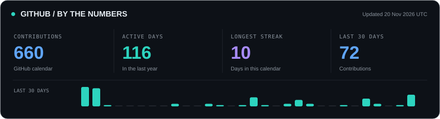

<h1 align="center">Ensar Yaman</h1>
<p align="center"><samp>FULL-STACK DEVELOPER &nbsp; / &nbsp; WEB · MOBILE · APIs</samp></p>
<p align="center"></p>
<p align="center"><strong>Thoughtful interfaces. Solid foundations.</strong><br />
I build across the stack, connecting the experience you see with the systems behind it.</p>

<p align="center">


</p>

---

### 01 &nbsp; / &nbsp; What I build

<table>
<tr>
<td width="33%" valign="top">
<h3>↗ Web</h3>
<p>Responsive interfaces and full-stack web applications.</p>
<sub><b>REACT · NEXT.JS · TYPESCRIPT</b></sub>
</td>
<td width="33%" valign="top">
<h3>⌁ Mobile</h3>
<p>Connected experiences across mobile platforms.</p>
<sub><b>REACT NATIVE · EXPO</b></sub>
</td>
<td width="33%" valign="top">
<h3>⌘ Backend</h3>
<p>Application services, APIs and data integrations.</p>
<sub><b>NODE.JS · LARAVEL · FIREBASE</b></sub>
</td>
</tr>
</table>

### 02 &nbsp; / &nbsp; The toolkit

<p><sub><b>WEB & INTERFACES</b></sub><br />


</p>

<p><sub><b>MOBILE</b></sub><br />


</p>

<p><sub><b>BACKEND & APIS</b></sub><br />


</p>

<p><sub><b>DATA & SERVICES</b></sub><br />


</p>

<p><sub><b>DEVELOPMENT & QUALITY</b></sub><br />


</p>

### 03 &nbsp; / &nbsp; GitHub activity

<p>

<br />

</p>
<sub>Updated daily from my GitHub contribution calendar.</sub>

### 04 &nbsp; / &nbsp; Behind the code

```typescript
const ensar = {
  focus: ["web", "mobile", "backend"],
  mindset: "Product first. Choose the right tools.",
  priorities: ["clarity", "maintainability", "user experience"],
};
```

<details>
<summary><b>A little more about my work</b></summary>
<br />

I work across the JavaScript, TypeScript and PHP ecosystems, from interfaces and APIs to service integrations. I care about clear architecture, performance, validation and testing.

Much of my current development takes place in private repositories. My contribution activity offers a broader view of my ongoing work.

</details>

---

<p align="center"><samp>GOOD SOFTWARE IS IN THE DETAILS.</samp></p>
